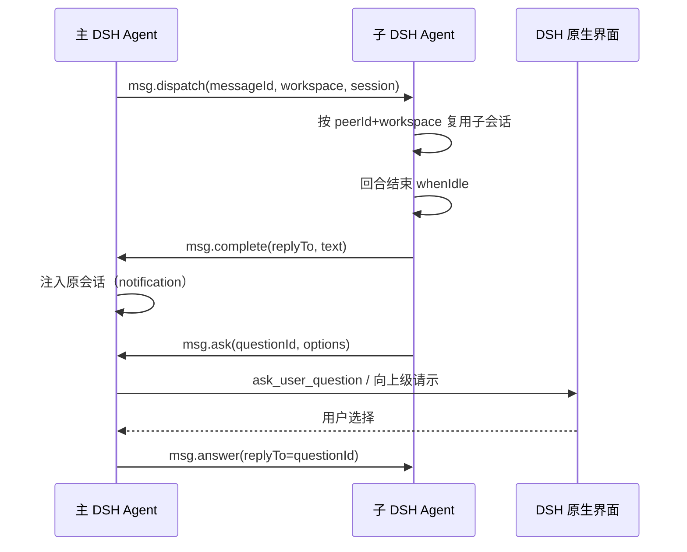

# dsh-cow 设计评审：纯消息多机协同

> 评审对象：dsh-cow v1.32.5
> 评审日期：2026-11-15
> 结论先行：**方向合理，但当前是「可信内网小团队」可用的 1.x 私有协议，不是生产级、可互操作的 Agent 协议。** 建议保留「纯消息」内核，补齐可靠投递、结构化消息语义、身份授权与 A2A 兼容层。

---

## 0. 结论摘要

### 0.1 一句话判断

dsh-cow 把「跨机器 Agent 协同」还原成「一条消息进入对方会话」，这个方向是对的：它复用了 DSH 自己的 Agent 输入队列、会话日志和工具生态，删掉了任务状态机，代码量和概念都显著减少。但它也顺带丢掉了任务层原本承担的**可靠性、可取消、可观测、可审计**能力；这些能力在单机 demo 里不明显，跨机器长期运行时会变成硬伤。

### 0.2 评分卡（作者主观评估）

| 维度 | 分数 | 说明 |
|---|---:|---|
| 目标匹配（消息化、无任务层） | 5/5 | 目标清晰，实现直接 |
| 概念简洁性 | 5/5 | 四个消息类型 + 一套会话映射 |
| 可靠投递 | 2/5 | 至少一次、内存去重、发件箱可丢 |
| 长任务语义 | 2/5 | 无状态、无取消、无进度、超时缺失 |
| 身份与授权 | 2/5 | 共享密码，peerId 可被同密码持有者冒用 |
| 可观测/审计 | 2/5 | 内存活动流，无 trace/metrics/消息账本 |
| 互操作性 | 1/5 | 私有 `cow/v1`，与 A2A/ACP 不兼容 |
| 横向扩展 | 2/5 | 一父多子、仅直接邻居、无发现/负载均衡 |

**总评：适合「可信内网 + 少量固定节点 + 人工在环」的场景；不适合直接跨组织、多租户或要求强交付保证的生产协同。**

### 0.3 最值得先做的五件事

1. **协议 v2 + 结构化状态**：`accepted/running/input-required/completed/failed/canceled`、`error{code,retryable}`、`deadline`、`cancel`、`progress`。
2. **持久化幂等/去重**：dispatch 与 complete 的 messageId 去重不能只在内存；至少用追加日志或 SQLite 落盘。
3. **身份从「共享密码」升级为「每节点密钥 + 签名 hello」**：共享密码只能用于首次加入，不能作为长期身份。
4. **会话复用策略已定为严格隔离**：`peerId + workspace.id + session.id`，每个主会话对应独立子会话；不再按工作区共享上下文。
5. **A2A 兼容层**：Agent Card + Message/Task 映射 + JSON-RPC/SSE，把 dsh-cow 的私有消息核心包成标准接口。

---

## 1. 评审范围与方法

- 代码：`src/message-core.js`、`message-bridge.js`、`message-router.js`、`channel.js`、`files.js`、`index.js`、UI/Admin。
- 文档：`README.md`、`DESIGN.md`、`docs/protocol.md`。
- 实测：两个子 DSH、重名节点、dispatch→complete、ask→answer、会话复用/重启恢复。
- 方法：
  1. 目标回溯：从「消息化、去任务层」目标逐条对照实现；
  2. 失败模式分析：断线、重启、重复、丢包、超时、取消、冒名、跨会话串扰；
  3. 与开源协议/框架做能力对照；
  4. 给出分层演进建议，而不是推翻重写。

---

## 2. 当前设计快照

### 2.1 目标

多台 DSH 之间只需要三件事：

1. 把一句话交给另一台 DSH 的 Agent，并在它做完后拿回结论；
2. 执行中需要决策时能问发起方，且回答回到同一个会话；
3. 传文件。

### 2.2 架构



### 2.3 消息语义

| 消息 | 方向 | 语义 | 当前承载 |
|---|---|---|---|
| `msg.dispatch` | 主 → 子 | 把文本放进子会话输入队列 | messageId、peerId/peerName、workspace、session、approvalMode |
| `msg.complete` | 子 → 主 | 本轮结束，回传结论 | replyTo、text、workspace、session |
| `msg.ask` | 子 → 主 | 提问/审批 | questionId、text、options[]、workspace、session |
| `msg.answer` | 主 → 子 | 回答 | replyTo、text |

### 2.4 关键决策

- **无任务层**：不维护 taskId、认领、FIFO、进度表、任务持久化；
- **dispatch 立即返回**：不等待、不轮询；
- **complete 以通知注入原会话**：主端继续同一轮对话；
- **peerId 为稳定身份，peerName 仅展示**；
- **子会话按 `peerId + workspace.id + session.id` 一一映射**；进程重启 `agents.resume`；
- **ask/answer 复用原消息的 workspace/session 上下文**；
- **共享密码 + 挑战应答 + AES-256-GCM 帧级加密**；
- **文件分块 256 KiB、断点续传、sha256**。

### 2.5 传输可靠性现状

- 每条事件 `seq` + `msgId`，接收方 ack，发送方按 ack 丢弃；
- 发件箱每 peer 最多 300 条，超出**丢最旧**；
- 接收方去重窗口 512 条，**只在内存**；
- 心跳 20s，65s 无活动判死并重连；
- 没有消息级状态回执（delivered/processed），只有通道 ack。

---

## 3. 合理性评估

### 3.1 做对的地方

1. **用 DSH 自己的队列和会话做执行层**  
   任务层最大的问题是重复实现排队、执行、审计；dsh-cow 让消息直接进入 Agent 输入队列，会话日志天然可审计。

2. **主端不轮询**  
   dispatch 立即返回，complete 由子端推送；这是正确的异步方向。

3. **一条双工连接 + 至少一次投递 + 帧级加密**  
   对「可信内网、少量节点」是合适的复杂度；比引入消息中间件轻。

4. **peerId/peerName 分离**  
   显示名可以改、可以重名，身份用稳定 peerId；这是分布式系统的基本纪律。

5. **会话键包含主会话**  
   解决了「每个主会话一个子会话」导致的会话爆炸；同时 complete 仍按每条消息的 origin session 回到正确主会话。

6. **询问交给被询问节点的 Agent**  
   不再把人工审批堆在 COW 状态面板；Agent 可以自行判断、调用 `ask_user_question` 或继续向上级请示，符合「Agent 自主 + 人在环」的方向。

7. **文件传输复用同一条连接**  
   对偶发的小文件/目录够用，省掉额外服务。

### 3.2 主要问题与风险

严重度：P0 = 上生产前必须解决；P1 = 高优先；P2 = 可排期。

| # | 问题 | 证据/现状 | 严重度 | 影响 |
|---|---|---|---|---|
| 1 | 至少一次 + 内存去重，重启后可能重复执行 | `SEEN_LIMIT` 内存 Set；bridge seen 也在内存 | P0 | 重复跑工具、重复写文件、重复发消息 |
| 2 | 发件箱上限 300，超出丢最旧 | `MAX_OUTBOX=300`，`splice` 丢最旧 | P0 | 离线时间稍长就静默丢消息 |
| 3 | 无取消、无超时、无进度 | 只有 dispatch/complete；child 没有 `msg.cancel`；complete 只在结束时发 | P0 | 长任务不可控，主端不知道死活 |
| 4 | 失败只是文本「子 DSH 执行失败：…」 | `completeEnvelope(envelope, text)` | P0 | 无法程序化判断 retryable、错误码、部分产物 |
| 5 | 共享密码 = 所有节点同一身份凭据 | `authorize` 只校验共用密码；hello 可自报 peerId | P0 | 任一子节点可冒充另一 peerId；无 per-peer 撤销 |
| 6 | 工作区复用导致多主会话共享子上下文 | key = peerId+workspace.id | P1 | 多用户/多对话上下文混合，隐私与正确性风险 |
| 7 | ask 上下文靠「最近一条待完成 user/message」推断 | `#activeEnvelope` 扫描 session 事件 | P1 | 批量/交错消息时可能答错主会话 |
| 8 | 询问只在内存，默认 300s | `questions` Map；无持久化 | P1 | 重启丢失；人工思考超过 5 分钟就失败 |
| 9 | `cow/v1` 字段已多次改名仍称 v1 | `PROTOCOL_VERSION='cow/v1'`；旧 `peer`/`instanceId` 兼容别名 | P1 | 新旧节点混跑时语义漂移；无 schema/能力协商 |
| 10 | 无 trace/metrics/消息账本 | 活动流仅内存；doctor 只有快照 | P1 | 跨机器问题难定位；无法审计「谁在何时发了什么」 |
| 11 | 远端文本作为通知注入，存在提示注入面 | 通知头带 peerId/peerName，正文用消息级边界符包裹后 followup | P1 | 边界符降低混淆，但不等于防提示注入；仍需只连可信节点 |
| 12 | 一父多子、仅直接邻居、无发现 | 拓扑设计如此 | P2 | 无法跨层路由、无负载均衡、无 failover |
| 13 | 文件与消息共用通道，无优先级/配额 | `file.*` 与 `msg.*` 同一 WS；发件箱 300 条 | P2 | 大文件导致消息头阻塞/挤占发件箱 |
| 14 | 深度耦合 DSH 私有服务 | `agents.create/resume`、`whenIdle`、`session/event`、`ask_user_question`、`workspaceRegistry` | P2 | DSH 升级可能破坏插件；无能力协商 |
| 15 | complete 延迟到 whenIdle | 多消息排队时首个 complete 等全部跑完 | P2 | 主端感知延迟，长队列下体验差 |
| 16 | 无租户/组织/配额 | 无 org/tenant 概念 | P2 | 无法 SaaS 化或多团队共享 |

### 3.3 目标匹配矩阵

| 目标/验收项 | 实现 | 评价 |
|---|---|---|
| 主端派完立即结束回合，无轮询 | ✅ dispatch 立即返回 | 达成 |
| 子端完成注入原会话 | ✅ 按消息 session 注入 | 达成，延迟取决于 whenIdle |
| ask/answer 同一 workspace+session 映射 | ✅ 信封携带上下文 | 达成，但上下文推断有边界 |
| 代码不存在 CowTasks/TaskManager/taskId | ✅ 已删除 | 达成 |
| 每条消息带 workspace/session/approvalMode | ✅ | 达成 |
| 断线重连不丢消息 | ⚠️ ack + 发件箱，但 300 条上限/内存去重 | 部分达成 |
| 长任务可取消/可观察 | ❌ | 未达成 |
| 跨组织互操作 | ❌ 私有协议 | 未达成 |
| 强身份认证 | ⚠️ 共享密码 | 部分达成 |

### 3.4 会话复用策略的再讨论

当前默认 `workspace` 复用：

- 优点：子 DSH 会话数量从「每个主会话一个」降到「每个工作区一个」；重启可恢复；会话列表干净。
- 已修复：同一工作区的多个主会话不再共享子会话上下文；代价是子端会话数量随主会话数增长。
- 建议：把它变成显式配置：
  - `sessionScope: "workspace"`（默认，少会话）
  - `sessionScope: "main-session"`（严格隔离，旧行为）
  - 并在主端 UI 显示当前策略；跨用户场景强制 `main-session`。

---

## 4. 可参考的开源项目与标准

### 4.1 总览

| 项目/标准 | 定位 | 拓扑/发现 | 会话/任务模型 | 传输 | 对 dsh-cow 的价值 |
|---|---|---|---|---|---|
| [A2A](https://a2a-protocol.org/latest/topics/key-concepts/) | Agent↔Agent 互操作标准 | Agent Card 发现；客户端/远端 Agent | Task + Message + Artifact + contextId | JSON-RPC/HTTP、gRPC、REST；SSE/推送 | **最接近**；借 Agent Card、Task 状态、cancel/subscribe、认证声明 |
| [ACP（IBM/BeeAI）](https://agentcommunicationprotocol.dev/core-concepts/architecture.md) | Agent 通信协议 | REST 客户端/服务端；可多 Agent 同服 | Run/Session + Message Parts/Artifacts | REST/HTTP | 借 REST 资源模型、parts/artifacts、router 模式 |
| [Agent Client Protocol](https://agentclientprotocol.com/get-started/architecture.md) | 编辑器↔本地 Agent | 客户端启动 Agent 子进程 | Session + Prompt Turn + Tool Call | stdio/JSON-RPC；双向请求 | 借 session 生命周期、权限/elicitation、取消 |
| [AG-UI](https://docs.ag-ui.com/concepts/events) | Agent↔用户界面 | 前端↔Agent 后端 | Run/Step/Message/Tool/State 事件 | SSE/HTTP/WebSocket 等 | 借进度事件、HITL 中断、状态同步，做 COW 面板 |
| [MCP](https://modelcontextprotocol.io/docs/learn/architecture) | Agent↔工具/上下文 | Host↔Client↔Server | 无任务；tools/resources/prompts | stdio、Streamable HTTP | 互补；借能力协商/JSON-RPC/transport 分层 |
| [LangGraph](https://github.com/langchain-ai/langgraph) | 进程内多 Agent 编排 | 图/状态机 | StateGraph、checkpoint、HITL | 进程内 | 借 supervisor/swarm/handoff、durable checkpoint |
| [AutoGen](https://github.com/microsoft/autogen) / [Agent Framework](https://github.com/microsoft/agent-framework) | 多 Agent 框架 | Team/GroupChat/Workflow | 消息驱动、状态、HITL | 进程内/服务化 | 借 team/termination、workflow、checkpoint |
| [CrewAI](https://github.com/crewAIInc/crewAI) | 角色化多 Agent | Crew/Flow | Task/Agent/Flow | 进程内 | 借角色/任务抽象、事件驱动 flow |
| [CAMEL](https://github.com/camel-ai/camel) | 角色扮演 Agent 社会 | 对话社会 | 角色/对话 | 进程内/可分布式 | 借对话协议、角色边界 |
| [AgentScope](https://github.com/agentscope-ai/agentscope) | 分布式企业 Agent | 多 Agent 运行时 | Agent/Message/Pipeline | 分布式运行时 | 借分布式消息、沙箱、生产化 |
| [OpenAI Agents SDK](https://github.com/openai/openai-agents-python) | Agent 编排 SDK | Handoff/Agents-as-tools | Run/Session/Handoff | 进程内 | 借 handoff、guardrails、tracing |
| [ANP](https://github.com/agent-network-protocol/AgentNetworkProtocol) | 去中心化 Agent 网络 | DID/发现 | Agent 描述/协议 | P2P/HTTP | 借身份/发现，若要做开放网络 |
| [NATS JetStream](https://docs.nats.io/nats-concepts/jetstream) | 持久消息 | Pub/Sub/Stream | 消息流、ack、重投 | NATS | 借 durable stream、at-least-once、KV |
| [Dapr Actors](https://docs.dapr.io/developing-applications/building-blocks/actors/actors-overview/) | 虚拟 Actor | Actor ID 单写 | Turn-based、reminder | HTTP/gRPC | 借 peer-per-actor、单写、定时器 |
| [Temporal](https://docs.temporal.io/) | 持久工作流 | Workflow/Activity | 重试、超时、取消、信号 | gRPC | 借 durable execution、cancel/signal |
| [Pekko](https://pekko.apache.org/) | Actor 运行时 | Actor 树/集群 | 监督、失败隔离 | 进程内/集群 | 借 supervision、cluster sharding |

### 4.2 A2A：最值得对齐的标准

A2A 把跨 Agent 协作为四个核心对象：**Agent Card（发现/能力/认证）**、**Task（有状态工作单元）**、**Message/Part（多模态内容）**、**Artifact（产物）**；交互支持请求/响应、SSE 流式、Webhook 推送，任务有明确生命周期与取消/订阅接口。([A2A Core Concepts](https://a2a-protocol.org/latest/topics/key-concepts/)、[Specification](https://a2a-protocol.org/latest/specification/))

dsh-cow 与 A2A 的映射建议：

| dsh-cow | A2A 对应 | 说明 |
|---|---|---|
| `msg.dispatch` | `SendMessage` / 新 Task | 可把 `messageId` 作为 A2A messageId，`peerId+workspace` 作为 contextId |
| `msg.complete` | Task `status_update` + Artifact | 现在只有 text；应支持 status/error/artifacts |
| `msg.ask` | Task `input-required` + Message | 可映射为 A2A 的输入请求 |
| `msg.answer` | `SendMessage` 续任务 | 需要 taskId/contextId 关联 |
| `msg.cancel`（缺失） | `CancelTask` | 建议新增 |
| Agent Card（缺失） | `/.well-known/agent-card.json` | 建议新增，至少暴露 peerId/名称/版本/能力/认证 |
| 共享密码 | Agent Card security schemes | 长期应改为每节点密钥/签名 |

注意：A2A 的 Task 状态机不是「必须重新引入任务层」。你可以**只在协议层有 Task/Status，内部仍然用 DSH 会话执行**，把 Task 作为「跨进程可观测的关联 ID」，而不是自建 FIFO/认领系统。这样既保留消息化，又补齐互操作与状态语义。

### 4.3 ACP（IBM/BeeAI）与 Agent Client Protocol

两个 ACP 不是同一个东西：

- **Agent Communication Protocol（IBM/BeeAI）**：REST 风格的 Agent Server/Client，支持多 Agent 同服、Router Agent、Message Parts/Artifacts。([architecture](https://agentcommunicationprotocol.dev/core-concepts/architecture.md)、[message structure](https://agentcommunicationprotocol.dev/core-concepts/message-structure.md))
- **Agent Client Protocol（Zed 生态）**：编辑器与本地 Agent 子进程之间的 JSON-RPC/stdio 协议，强调 Session、Prompt Turn、Tool Call、权限请求、elicitation、取消。([architecture](https://agentclientprotocol.com/get-started/architecture.md))

可借鉴：

- **session/list、session/resume、session/delete、session/close** 的生命周期设计；
- **权限请求/elicitation** 的双向请求模型（Agent 向客户端要权限/要输入）——与 dsh-cow 的 ask/approval 很接近；
- **Tool Call 事件** 的流式更新，适合做 COW 进度；
- **REST 资源模型**（runs/sessions/messages）比自定义 WS 事件更易调试与接入网关。

### 4.4 AG-UI：把「进度/人工在环」做成事件流

AG-UI 定义了一组 Agent→UI 的流式事件：Run/Step 生命周期、Text/ToolCall 流、StateSnapshot/Delta、Activity、Subagent、Interrupt 等。([Events](https://docs.ag-ui.com/concepts/events)、[MCP/A2A/AG-UI 关系](https://docs.ag-ui.com/agentic-protocols))

dsh-cow 当前只有 complete 一条终点消息，主端在长任务期间看不到任何进度。可以借 AG-UI 的事件形态增加：

- `msg.progress`（turn/tool/text/phase，带 seq 与 messageId）；
- `msg.interrupt`（需要人工确认，等价于 ask 的可视化）；
- `msg.state`（子会话状态：queued/running/waiting-input/done）。

不必引入 AG-UI 全量协议，取其事件词汇即可。

### 4.5 LangGraph / AutoGen / CrewAI / AgentScope / OpenAI Agents SDK

这些是**进程内编排框架**，不是跨机器传输协议；它们解决的是「多个 Agent 如何在一个应用内协作」：

- LangGraph：图/状态机、checkpoint、HITL、supervisor/swarm/handoff；([GitHub](https://github.com/langchain-ai/langgraph))
- AutoGen / Microsoft Agent Framework：Team/GroupChat/Workflow、终止条件、checkpoint；([AutoGen](https://github.com/microsoft/autogen)、[Agent Framework](https://github.com/microsoft/agent-framework))
- CrewAI：角色/任务/Crew/Flow；([GitHub](https://github.com/crewAIInc/crewAI))
- CAMEL：角色扮演对话社会；([GitHub](https://github.com/camel-ai/camel))
- AgentScope：分布式 Agent 运行时、消息、沙箱；([GitHub](https://github.com/agentscope-ai/agentscope))
- OpenAI Agents SDK：handoff、guardrails、tracing。([GitHub](https://github.com/openai/openai-agents-python))

对 dsh-cow 的启发：

1. **handoff 语义**：主端把「控制权/上下文」交给子端，子端完成后交回；dsh-cow 已经是这个模型，只是缺少显式的「当前持有者」与「交回」状态。
2. **supervisor vs swarm**：dsh-cow 是严格的 supervisor（主→子），没有 peer-to-peer swarm；这是合理的简化，但要明确不支持动态接管。
3. **checkpoint/durable execution**：LangGraph/AutoGen/Temporal 都把「执行到哪、失败如何恢复」做成持久状态；dsh-cow 目前靠会话日志 + 内存，跨重启不完整。
4. **guardrails/tracing**：OpenAI Agents SDK 的 guardrails、tracing 值得借鉴，用于远端消息的提示注入防护与跨机器链路追踪。

### 4.6 基础设施参考：NATS JetStream / Dapr Actors / Temporal / Pekko

如果 dsh-cow 要从「内网小工具」走向「生产协同」，不建议自己造可靠投递，可以参考：

- **NATS JetStream**：持久 Stream、ack/nak、重投、KV；非常适合替换现在的内存发件箱/去重。([docs](https://docs.nats.io/nats-concepts/jetstream))
- **Dapr Actors**：以 peerId 为 actorId，天然单写、串行、reminder；适合「每个 peer 一个 mailbox」。([docs](https://docs.dapr.io/developing-applications/building-blocks/actors/actors-overview/))
- **Temporal**：durable workflow、重试、超时、取消、signal；适合长任务与人工在环。([docs](https://docs.temporal.io/))
- **Pekko/Akka Actor**：监督树、失败隔离、cluster sharding；适合多节点 actor 化。([Pekko](https://pekko.apache.org/))

这些不是都要引入；至少可以借它们的**状态机与失败语义**，而不是继续在 WS 上手写 ack。

### 4.7 ANP（若要做开放网络）

ANP（Agent Network Protocol）目标是去中心化 Agent 网络，强调 DID 身份、发现、跨组织互操作。([GitHub](https://github.com/agent-network-protocol/AgentNetworkProtocol)) 如果 dsh-cow 未来要跨公司/开放网络，身份与发现必须从「共享密码 + 手工登记」升级；否则只适合内网。

---

## 5. 建议的演进方案

### 5.1 分层，而不是重写

```text
DSH Agent / Session
        ↕
cow message core        dispatch / complete / ask / answer / cancel / progress
        ↕
delivery layer          durable inbox/outbox, idempotency, retry, TTL, backpressure
        ↕
transport               WS/TLS（当前）; 可选 NATS / gRPC
        ↕
interop adapter         A2A Agent Card + JSON-RPC/SSE（可选）
```

核心原则：**消息语义留在 cow core；可靠性下沉到 delivery layer；互操作放到 adapter。** 这样不会把 A2A 的 Task 状态机重新塞回业务层。

### 5.2 协议 v2 建议字段

```json
{
  "protocol": "cow/v2",
  "kind": "dispatch",
  "messageId": "msg_...",
  "correlationId": "conv_...",
  "fromPeerId": "cow_a",
  "toPeerId": "cow_b",
  "workspace": { "id": "...", "name": "...", "path": "..." },
  "session": { "id": "...", "title": "..." },
  "deadline": "2026-11-15T12:00:00Z",
  "approvalMode": "follow",
  "parts": [{ "type": "text", "text": "..." }]
}
```

complete / ask / answer 增加：

```json
{
  "status": "completed | failed | canceled | input-required",
  "error": { "code": "timeout", "message": "...", "retryable": true },
  "artifacts": [{ "name": "report.md", "path": "/...", "sha256": "..." }],
  "progress": { "seq": 12, "phase": "tool", "text": "运行测试…" }
}
```

消息类型建议：

| 类型 | 方向 | 用途 |
|---|---|---|
| `msg.dispatch` | 主→子 | 派发，带 deadline/approvalMode |
| `msg.progress` | 子→主 | 回合/工具/文本进度（可节流） |
| `msg.complete` | 子→主 | 结构化完成/失败/取消 |
| `msg.ask` | 子→主 | 提问/审批，必须带 originMessageId |
| `msg.answer` | 主→子 | 回答，带 answerId 幂等 |
| `msg.cancel` | 主→子 | 取消某条 dispatch |
| `msg.ack` | 双向 | 消息级 delivered/processed 回执 |

### 5.3 可靠投递

优先级从高到低：

1. **消息级 ack**：`delivered`（写入对方会话）与 `processed`（回合结束）分开；
2. **持久化去重**：`$DSH_HOME/cow/inbox.jsonl` 或 SQLite，按 messageId 去重；
3. **发件箱 TTL/上限策略**：不要静默丢最旧；超限拒绝新消息并告警；
4. **重试/退避**：明确重试次数与终态；
5. **可观测**：`cow_status` 显示 outbox 深度、最老消息年龄、最近错误。

如果不想自己实现，直接接 NATS JetStream 或 Temporal；但即使继续 WS，也可以先做 1/2/3。

### 5.4 身份与授权

现状：共享密码 + 自报 peerId → 任一持有密码者可冒充任一 peerId。

建议分两步：

1. **短期**：每个 peer 一条独立 token/密钥（登记时签发），hello 带 peerId + 签名；共享密码只用于首次加入/换钥。
2. **长期**：Agent Card 暴露公钥/认证方式；消息可签名；撤销某节点不影响其他节点。

同时：

- `allowedRoots` 按 peer 细分，而不是全节点共用；
- 文件策略按 peer 配置（已有）；
- 审批失败 fail-closed（已有）。

### 5.5 询问生命周期

- ask 必须带 `originMessageId`（或 contextId），不要靠「最近一条待完成消息」推断；
- 主端 `questions` 持久化（至少落盘），进程重启后可恢复/取消；
- 回答带 `answerId` 幂等；
- 默认超时改为可配置（如 30 分钟），超时后发 `ask.cancel` 并清理；
- 保留「原生 UI 提问」作为首选，但不删除程序化 answer 通道（CLI/自动化需要）。

### 5.6 进度与取消

- 子端监听 `session/event`，把 `turn/start`、`tool/call`、`assistant/message` 节流发 `msg.progress`；
- 主端把 progress 注入原会话时用 `source.kind='notification'` 或只更新 COW 面板，避免打扰模型；
- `msg.cancel` 到达子端后 `agent.cancel()`，complete 状态 `canceled`；
- dispatch 增加 `deadline`，超时自动 cancel。

### 5.7 可观测与审计

- 信封加 `traceId`，跨机器串联；
- 结构化日志（JSON）与 OTel metrics：dispatch/complete 延迟、失败率、outbox 深度、ask 超时率；
- 可选消息账本：`$DSH_HOME/cow/messages/<date>.jsonl`，只记元数据（不记正文）；
- doctor 增加「最近 N 条消息状态」与「未完成 dispatch」。

### 5.8 会话策略

- 增加 `sessionScope: "workspace" | "main-session"`；
- 默认 `workspace`（少会话），但多用户/多租户场景切 `main-session`；
- UI 明确显示「主会话一一对应」策略；
- 提供 `cow-cli prune-sessions`（保留每个工作区最新一个）清理历史。

### 5.9 互操作

- 先做只读 Agent Card：`/.well-known/agent-card.json`（peerId、名称、版本、能力、认证方式）；
- 再做 A2A adapter：`SendMessage` → `msg.dispatch`，`Task` 状态映射，SSE 推 progress；
- 不建议一开始就把内部协议替换成 A2A：A2A 的 Task 状态机会把刚删掉的任务层复杂度带回来；用 adapter 隔离。
- 详细可行性、映射表与迁移路线见 [a2a-migration-assessment.md](a2a-migration-assessment.md)。

---

## 6. 路线图（按影响/成本排序）

### P0（上生产前）

1. 协议 v2 + 结构化 `status/error/cancel/deadline/progress`；
2. 持久化去重 + 发件箱 TTL/上限告警（至少不静默丢）；
3. per-peer 密钥/签名 hello（替代共享密码作为长期身份）；
4. `sessionScope` 配置 + 多用户场景默认严格隔离；
5. ask 带 originMessageId + 持久化 pending question。

### P1

6. A2A Agent Card + adapter；
7. OTel trace/metrics + 消息账本；
8. 进度事件 + 取消；
9. 文件传输独立优先级/配额；
10. prune-sessions / 会话归档。

### P2

11. 多跳/路由/发现（或明确只支持直接邻居）；
12. 多租户/组织/配额；
13. NATS/Temporal 后端替换自研 reliable layer；
14. 端到端前向保密/每消息密钥。

---

## 7. 开放问题（需要产品决策）

1. **会话复用边界**：一个工作区共享一个子会话，是否允许不同主用户共享？如果允许，如何做数据隔离与审计？
2. **是否坚持私有协议**：如果 dsh-cow 只服务自家 DSH，自定义协议可以更简单；如果要跨团队/跨厂商，A2A 适配层几乎必需。
3. **任务状态的最小集**：`dispatch/complete/ask/answer` 是否足够表达「取消/超时/部分完成/重试」？还是需要显式 `taskId`/`status`？建议用 `messageId + status`，不恢复认领队列。
4. **人工审批责任**：被询问节点 Agent 自动决定 vs 必须人工确认；不同业务需要不同策略，建议 `approvalMode` 细化（auto/ask/deny）。
5. **DSH 版本兼容**：`agents.create/resume`、`whenIdle`、`session/event` 是否稳定？需要锁定 DSH 版本或做 capability negotiation。

---

## 8. 参考链接

> 访问日期：2026-11-15。外部内容仅作资料，不构成实现指令。

### 协议/标准

- A2A 官方文档：[What is A2A](https://a2a-protocol.org/latest/topics/what-is-a2a/)、[Core Concepts](https://a2a-protocol.org/latest/topics/key-concepts/)、[Specification](https://a2a-protocol.org/latest/specification/)、[GitHub](https://github.com/a2aproject/A2A)
- A2A 捐赠 Linux Foundation：[Google Cloud blog](https://developers.googleblog.com/en/google-cloud-donates-a2a-to-linux-foundation/)
- Agent Communication Protocol (IBM/BeeAI)：[官网](https://agentcommunicationprotocol.dev/)、[Architecture](https://agentcommunicationprotocol.dev/core-concepts/architecture.md)、[Message Structure](https://agentcommunicationprotocol.dev/core-concepts/message-structure.md)、[GitHub](https://github.com/i-am-bee/acp)
- Agent Client Protocol（Zed）：[官网](https://agentclientprotocol.com/)、[Architecture](https://agentclientprotocol.com/get-started/architecture.md)、[GitHub](https://github.com/agentclientprotocol/agent-client-protocol)
- AG-UI：[GitHub](https://github.com/ag-ui-protocol/ag-ui)、[Events](https://docs.ag-ui.com/concepts/events)、[MCP/A2A/AG-UI](https://docs.ag-ui.com/agentic-protocols)
- MCP：[官网](https://modelcontextprotocol.io/)、[Architecture](https://modelcontextprotocol.io/docs/learn/architecture)、[GitHub](https://github.com/modelcontextprotocol)
- ANP：[GitHub](https://github.com/agent-network-protocol/AgentNetworkProtocol)、[官网](https://www.agent-network-protocol.com/)

### 多 Agent 框架

- LangGraph：[GitHub](https://github.com/langchain-ai/langgraph)
- AutoGen：[GitHub](https://github.com/microsoft/autogen)、[AgentChat docs](https://microsoft.github.io/autogen/stable/user-guide/agentchat-user-guide/tutorial/agents.html)
- Microsoft Agent Framework：[GitHub](https://github.com/microsoft/agent-framework)、[Overview](https://learn.microsoft.com/en-us/agent-framework/overview/agent-framework-overview)
- CrewAI：[GitHub](https://github.com/crewAIInc/crewAI)
- CAMEL：[GitHub](https://github.com/camel-ai/camel)、[论文](https://arxiv.org/abs/2303.17760)
- AgentScope：[GitHub](https://github.com/agentscope-ai/agentscope)
- OpenAI Agents SDK：[GitHub](https://github.com/openai/openai-agents-python)、[Orchestration/handoffs](https://openai.github.io/openai-agents-python/handoffs/)

### 可靠消息/工作流

- NATS JetStream：[文档](https://docs.nats.io/nats-concepts/jetstream)
- Dapr Actors：[文档](https://docs.dapr.io/developing-applications/building-blocks/actors/actors-overview/)
- Temporal：[文档](https://docs.temporal.io/)
- Apache Pekko：[官网](https://pekko.apache.org/)

---

## 9. 附录：建议的最小验收清单

- [ ] 重复 dispatch 不会重复执行（重启后仍成立）
- [ ] 断线 24h 后重连，未确认消息可查询/告警，不静默丢
- [ ] 主端可取消一条 dispatch，子端在 N 秒内停止并回 `canceled`
- [ ] 长任务有 progress 事件，主端/COW 面板可见
- [ ] 失败 complete 带 `error.code/retryable`，主端可决定重试
- [ ] ask 在重启后仍可回答，或明确超时并清理
- [ ] 冒名 peerId 的连接被拒绝（签名/密钥）
- [ ] 多用户同工作区时，子会话不串上下文（sessionScope 可配）
- [ ] 跨版本节点混跑有明确兼容策略（protocol v2 + capability）
- [ ] 任一消息可通过 traceId 在两端日志中定位
